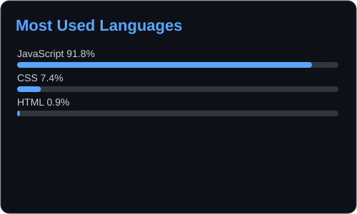
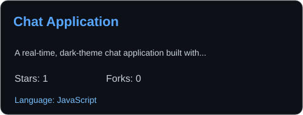
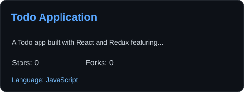
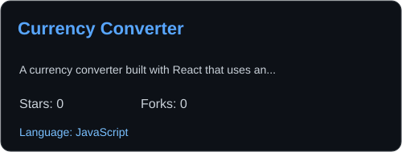
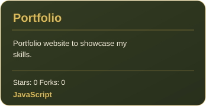

<!-- HERO -->

  

<!-- TYPING ANIMATION -->

  

<!-- PROFILE BADGES -->

  
  
  

<!-- CONNECT -->

  

  

  

  

<h2 align="center">👋 Hey, I'm Divyashish</h2>

  <b>Turning logic into real-world solutions with code, creativity, and consistency.</b>

---

## 🌸 About Me

- 🌱 Full-Stack Development & Advanced DSA
- 🧠 Problem Solving & System Thinking
- 💻 Building real-world impactful projects
- 🛠️ Exploring scalable architectures
- ⚡ Coffee + curiosity + consistency

---

## 🎯 Current Goals

- 🚀 Crack top tech roles
- 📈 Improve DSA daily
- 🛠️ Build production-level applications
- 💡 Strengthen Java, SQL, and problem-solving skills

---

## 🔗 My Work

  

  

---

## 🛠️ Tech Stack & Tools

  
  
  
  

<h3 align="center">🛠️ Tech Stack</h3>

  

---

## 📈 GitHub Stats

  

---

## 🔥 Most Used Languages

  

---

## 🚀 Featured Projects

<!-- CHAT APPLICATION -->

  

<!-- TODO APPLICATION -->

  

<!-- CURRENCY CONVERTER -->

  

<!-- PORTFOLIO -->

  

---

## 🏆 Mindset

- 🧩 Break complex problems into simple solutions
- 📚 Learn daily
- ⚡ Consistency > motivation
- 🏗️ Build → Improve → Repeat

---

  <i>🔥 "Stay consistent when it's hard — that's where winners are built."</i>

<!-- FOOTER -->

  

